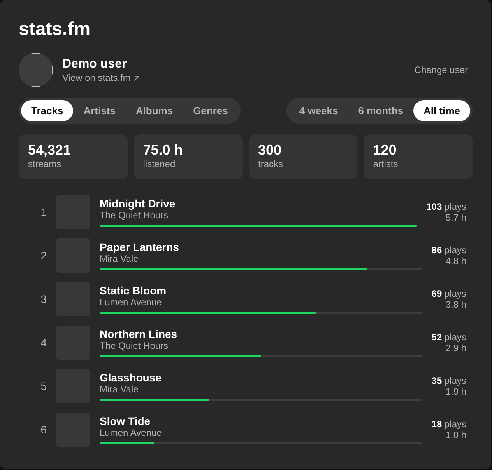

# stats.fm for Spicetify

A [Spicetify](https://spicetify.app) extension that shows your [stats.fm](https://stats.fm) listening stats inside Spotify.



> [!IMPORTANT]
> **"All time" only shows what stats.fm has.** stats.fm only records plays from after you create your account, so a new account will show the same numbers for 4 weeks, 6 months and All time.
>
> To see your full listening history:
> 1. On [spotify.com](https://www.spotify.com/account/privacy/), go to **Account → Security and privacy → Account privacy**.
> 2. Under "Download your data", tick **Extended streaming history** and click **Request data**. Spotify emails it to you, which can take up to 30 days.
> 3. Upload the zip you receive on [stats.fm](https://stats.fm) under **Settings → Imports**.
>
> Once stats.fm finishes processing the import, this extension shows your full history automatically.

## Features

- **Top tracks, artists, albums and genres** for the last 4 weeks, 6 months or all time
- **Summary cards**: streams, hours listened, daily averages, and unique tracks and artists
- **Click any row** to open that track, artist or album in Spotify
- **Right-click a song → "stats.fm plays"** to see how often you've played it
- Uses the public stats.fm API, **not Spotify's Web API**, so it isn't affected by Spotify's `429 Too Many Requests` rate limits

## Requirements

- A [stats.fm](https://stats.fm) account with a **public** profile (stats.fm → Settings → Privacy)
- Spicetify

## Install

### Spicetify Marketplace

Search for **stats.fm for Spicetify** in the Marketplace and click Install.

### Manual

1. Download [`statsfm.js`](statsfm.js).
2. Put it in your Spicetify `Extensions` folder:
   - Windows: `%LOCALAPPDATA%\spicetify\Extensions` (older installs: `%APPDATA%\spicetify\Extensions`)
   - Linux / macOS: `~/.config/spicetify/Extensions`
3. Run:
   ```bash
   spicetify config extensions statsfm.js
   spicetify apply
   ```

## Usage

Click the **stats.fm** button in the top bar (or find it in the profile menu), then enter your stats.fm username or paste your profile link.

## Notes

- Results are cached for 5 minutes.

## Disclaimer

This is an unofficial, community-made extension. It is not affiliated with or endorsed by stats.fm or Spotify.

## License

[MIT](LICENSE)
